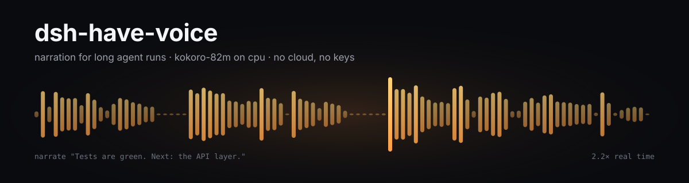

<p align="center">
  
</p>

<p align="center">
  <a href="https://www.python.org/"></a>
  <a href="https://github.com/microsoft/onnxruntime"></a>
  
  
  
  
<a href="https://github.com/retampweb/dsh-have-voice/actions/workflows/ci.yml"></a>
</p>

<p align="center"><b>English</b> · <a href="README.zh.md">中文</a> · <a href="docs/demo.mp3">listen: 16 seconds</a></p>

---

**Your agent works for twenty minutes. You are in another window. It tells you what happened — in
its own words, in eight seconds.**

This is a narration layer for long agent runs: a local voice daemon, an MCP tool the model calls
when something is worth saying, and a rule for what that sounds like.

```bash
./install.sh                  # venv, dependencies, weights, smoke test
./vox serve &                 # warm daemon on 127.0.0.1:8765
./vox say "Yes. It works."
```

## Why narration

Reading answers aloud is the wrong unit of speech. Long runs are made of milestones, and the person
listening is usually busy: another window, another task, a coffee, a walk around the room. What
they need is not the reply. It is three things: what just happened, how it went, what comes next.

The words have to be written for that moment. A canned "Task completed successfully" wears out by
the third repetition; a line written by the model that did the work sounds like a colleague:

> Tests are green, forty two of forty two. Next I'm taking the API layer.
>
> That type error was mine, the retry path returned the wrong shape. Fixed it, build is clean.
>
> Deploy is live. Nothing is on fire, and the last thing left is the changelog.

Those three lines are [`docs/demo.mp3`](docs/demo.mp3).

## The rule

1. **What I did, how it went, what comes next.** Two sentences, under eight seconds.
2. **Milestones only** — a batch finished, tests came back, something broke, I am blocked.
3. **Written fresh every time**, by the model, for that moment. No templates, no status fields read
   aloud, no todo list.
4. **Quiet when nothing changed.** Frequent speech is the point; noise is the failure.

The same rule ships in [`skill/SKILL.md`](skill/SKILL.md), and the tool description in
[`mcp/server.py`](mcp/server.py) repeats it for agents that never read docs.

## Narrate from an agent

The MCP server exposes `narrate` and `voice_status`. DSH, Claude Desktop, Cursor and anything else
that speaks MCP can use it.

```yaml
# DSH profile patch
- insert:
    - id: mcp-voice
      name: "@deepseek-ai/dsh-mcp-client"
      config:
        serverName: voice
        transport: stdio
        command: "/usr/bin/python3"
        args: ["<repo>/mcp/server.py"]
        toolCallTimeoutMs: 30000
```

```json
// Claude Desktop / Cursor: mcpServers
{"voice": {"command": "python3", "args": ["<repo>/mcp/server.py"]}}
```

Without MCP, `vox say "..."` does the same thing from a shell.

## How it works

```
agent ──narrate──▶ MCP stdio ──▶ voxd 127.0.0.1:8765
                                  │  split into sentences
                                  │  sha1(sentence, voice) → out/cache/*.wav
                                  ▼
                           kokoro_worker.py (onnxruntime + espeak-ng)
                                  │  ~2.2× real time
                                  ▼
                             wav ──▶ player thread ──▶ pw-play
```

- **Resident daemon.** A cold load costs 3.5 s, so one process keeps the model in memory.
- **Worker in its own process.** Kokoro needs onnxruntime and espeak-ng; the daemon needs neither.
- **Sentence splitter.** Each sentence is synthesized in turn and handed to the player the moment
  it exists, so the first sound arrives long before the last word.
- **Cache on the sentence.** Repeats cost nothing, and the same update never sounds different twice.

## Benchmarks

Measured on a Xeon E5-2673 v3 (Haswell, 24 threads, no GPU), Python 3.14, onnxruntime 1.31.
Reproduce with `tools/venv/bin/python tests/bench.py`.

| line | audio | synthesis | speed |
|---|---:|---:|---:|
| short | 1.71 s | 0.77 s | 2.22× |
| medium | 4.97 s | 2.48 s | 2.00× |
| long | 5.38 s | 2.33 s | 2.31× |

| metric | value |
|---|---|
| median speed | **2.22× real time** |
| model load, cold | 3.55 s |
| first sentence, cold | 0.93 s |
| first sentence, cached | 0.00 s |
| four-sentence reply | 5.96 s end to end |
| HTTP roundtrip | ~2 ms |
| disk | 338 MB (311 MB model + 27 MB voices) |

**int8 runs slower on this CPU.** The quantized model took 4.17 s for 4.14 s of audio (1.0×);
fp32 took 1.84 s for 4.22 s (2.3×). Haswell has no AVX-512 VNNI, so int8 matmuls are emulated.
311 MB beats 114 MB here, and the table above shows it.

## Using it

```bash
vox say "text" [voice]     # af_heart (default) | bf_emma | af_bella | af_nicole | af_sarah | am_michael
vox serve [--port 8765] [--no-play]
vox status
vox digest report.md
vox listen                 # ears: pw-record → Underdog Bark 3.0 (optional, not installed)

VOX_PLAY=afplay vox serve  # macOS; VOX_PLAY=aplay on ALSA systems
```

```http
POST /say   {"text": "Yes, two lines.", "voice": "af_heart"}
→ 200 {"ok": true, "job": "24bff82b", "voice": "af_heart", "sentences": 2, "cached": false}

GET /health
→ 200 {"ok": true, "queue": 0, "play": true, "voice": "af_heart", "voices": [...]}
```

## Design notes

- **The model owns the words.** The daemon renders whatever it is handed, which is why updates
  never repeat a canned phrasing.
- **The cache key is the sentence and the voice.** Same words, same bytes, zero cost.
- **No framework.** stdlib `http.server`, one subprocess, one thread. 150 lines.
- **The daemon never blocks.** `/say` enqueues and returns in ~2 ms, so an agent turn stalls on
  nothing.

## Limitations

- **English voices.** The bundled voice pack is English.
- **2.2× means a four-second sentence costs about 1.8 s.** Comfortable for updates, slow for
  reading a document out loud.
- **Sentence splitting can clip prosody** at the joins. Noticeable on literary text.
- **Linux and PipeWire** (`pw-play`). Set `VOX_PLAY` to `aplay` or `afplay` elsewhere.
- **espeak-ng data** is required for phonemization; `install.sh` unpacks it when the system has none.
- **No ears.** `vox listen` needs Underdog Bark 3.0 and torch; not installed by default.

## Credits

- [Kokoro-82M](https://huggingface.co/hexgrad/Kokoro-82M) — Apache 2.0 weights, by hexgrad.
- [kokoro-onnx](https://github.com/thewh1teagle/kokoro-onnx) — ONNX runtime and model exports.
- [onnxruntime](https://github.com/microsoft/onnxruntime), [espeak-ng](https://github.com/espeak-ng/espeak-ng).

Code in this repo: MIT (see `LICENSE`).
