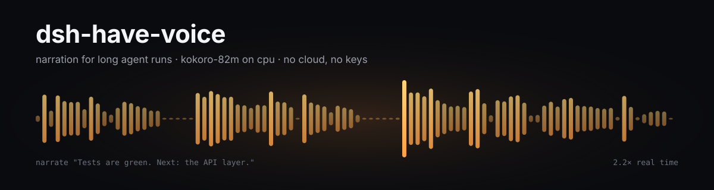

<p align="center">
  
</p>

<p align="center">
  <a href="https://www.python.org/"></a>
  <a href="https://github.com/microsoft/onnxruntime"></a>
  
  
  
  
<a href="https://github.com/retampweb/dsh-have-voice/actions/workflows/ci.yml"></a>
</p>

<p align="center"><a href="README.md">English</a> · <b>中文</b> · <a href="docs/demo.mp3">试听：16 秒</a></p>

---

**智能体干活二十分钟，你人在另一个窗口。它用八秒钟告诉你刚才发生了什么——用自己的话。**

这是一个给长时间任务配的旁白层：本地语音守护进程、一个模型主动调用的 MCP 工具、以及一套
关于「听起来该是什么样」的规则。

```bash
./install.sh                  # 虚拟环境、依赖、权重、冒烟测试
./vox serve &                 # 常驻服务，监听 127.0.0.1:8765
./vox say "Yes. It works."
```

## 为什么是旁白

把答案整段念出来，是把语音用错了地方。长任务由一个个里程碑组成，而听的人通常在忙：另一个
窗口、另一件事、一杯咖啡、在屋里走两圈。他要的从来不是答案，而是三件事：刚才做了什么、结果
如何、接下来做什么。

这些话必须为那一刻现写。罐头式的「任务已完成」到第三遍就失效；由真正干活的模型写出来的一句，
听起来才像同事：

> Tests are green, forty two of forty two. Next I'm taking the API layer.
>
> That type error was mine, the retry path returned the wrong shape. Fixed it, build is clean.
>
> Deploy is live. Nothing is on fire, and the last thing left is the changelog.

这三句就是 [`docs/demo.mp3`](docs/demo.mp3)。

## 规则

1. **做了什么、结果如何、接下来做什么。** 两句，八秒以内。
2. **只在里程碑开口**：一批活干完、测试回来、东西坏了、被卡住了。
3. **每次都现写**，由模型为当下这一刻写。不用模板，不念状态字段，不念待办列表。
4. **没有变化就闭嘴。** 频繁是目的，噪音是失败。

同一套规则写在 [`skill/SKILL.md`](skill/SKILL.md) 里，[`mcp/server.py`](mcp/server.py) 的工具描述
也复述了一遍，给那些不看文档的智能体。

## 让智能体开口

MCP 服务提供 `narrate` 与 `voice_status`。DSH、Claude Desktop、Cursor，任何支持 MCP 的客户端
都能用。

```yaml
# DSH 配置补丁
- insert:
    - id: mcp-voice
      name: "@deepseek-ai/dsh-mcp-client"
      config:
        serverName: voice
        transport: stdio
        command: "/usr/bin/python3"
        args: ["<repo>/mcp/server.py"]
        toolCallTimeoutMs: 30000
```

```json
// Claude Desktop / Cursor：mcpServers
{"voice": {"command": "python3", "args": ["<repo>/mcp/server.py"]}}
```

不接 MCP 时，`vox say "..."` 在命令行里做同一件事。

## 工作原理

```
agent ──narrate──▶ MCP stdio ──▶ voxd 127.0.0.1:8765
                                  │  按句子切分
                                  │  sha1(sentence, voice) → out/cache/*.wav
                                  ▼
                           kokoro_worker.py（onnxruntime + espeak-ng）
                                  │  约 2.2× 实时
                                  ▼
                             wav ──▶ 播放线程 ──▶ pw-play
```

- **常驻守护进程。** 冷启动 3.5 秒，所以由一个进程把模型留在内存里。
- **模型在独立进程。** Kokoro 需要 onnxruntime 和 espeak-ng，守护进程两者都不用装。
- **按句切分。** 每句依次合成，一生成就交给播放线程，第一个声音远早于最后一句话。
- **按句缓存。** 重复免费，同一句旁白不会两次听起来不一样。

## 基准测试

在 Xeon E5-2673 v3（Haswell，24 线程，无 GPU）、Python 3.14、onnxruntime 1.31 上实测。
运行 `tools/venv/bin/python tests/bench.py` 可复现。

| 句子 | 音频 | 合成 | 速度 |
|---|---:|---:|---:|
| 短 | 1.71 s | 0.77 s | 2.22× |
| 中 | 4.97 s | 2.48 s | 2.00× |
| 长 | 5.38 s | 2.33 s | 2.31× |

| 指标 | 数值 |
|---|---|
| 速度中位数 | **2.22× 实时** |
| 模型冷加载 | 3.55 s |
| 第一句（冷） | 0.93 s |
| 第一句（命中缓存） | 0.00 s |
| 四句回复，端到端 | 5.96 s |
| HTTP 往返 | ~2 ms |
| 磁盘占用 | 338 MB（311 MB 模型 + 27 MB 音色） |

**在这台机器上 int8 更慢。** 量化模型 4.14 秒音频用了 4.17 秒（1.0×），fp32 4.22 秒音频只用
1.84 秒（2.3×）。Haswell 没有 AVX-512 VNNI，int8 矩阵乘只能模拟。所以 311 MB 打赢 114 MB，
上面的表格就是证据。

## 用法

```bash
vox say "text" [voice]     # af_heart（默认）| bf_emma | af_bella | af_nicole | af_sarah | am_michael
vox serve [--port 8765] [--no-play]
vox status
vox digest report.md
vox listen                 # 耳朵：pw-record → Underdog Bark 3.0（可选，默认未安装）

VOX_PLAY=afplay vox serve  # macOS；ALSA 系统用 VOX_PLAY=aplay
```

```http
POST /say   {"text": "Yes, two lines.", "voice": "af_heart"}
→ 200 {"ok": true, "job": "24bff82b", "voice": "af_heart", "sentences": 2, "cached": false}

GET /health
→ 200 {"ok": true, "queue": 0, "play": true, "voice": "af_heart", "voices": [...]}
```

## 设计说明

- **话由模型写。** 守护进程只负责把它交来的句子念出来，所以旁白不会重复同一句罐头话。
- **缓存键是句子加音色。** 同样的词，同样的字节，零成本。
- **不用框架。** 标准库 `http.server`、一个子进程、一个线程，共 150 行。
- **守护进程从不阻塞。** `/say` 约 2 ms 入队返回，智能体的一轮对话不会卡在音频上。

## 已知限制

- **英文音色。** 内置音色包是英语的。
- **2.2× 意味着 4 秒的句子要算约 1.8 秒。** 旁白够用，朗读长文偏慢。
- **按句切分会在拼接处影响语调。** 文学作品比较明显。
- **Linux + PipeWire**（`pw-play`）。其他平台把 `VOX_PLAY` 换成 `aplay` 或 `afplay`。
- **需要 espeak-ng 数据**（音素化依赖），系统没有时 `install.sh` 会解包自带的。
- **暂时没有耳朵。** `vox listen` 需要 Underdog Bark 3.0 和 torch，默认不安装。

## 致谢

- [Kokoro-82M](https://huggingface.co/hexgrad/Kokoro-82M) —— Apache 2.0 权重，作者 hexgrad。
- [kokoro-onnx](https://github.com/thewh1teagle/kokoro-onnx) —— ONNX 运行时与模型导出。
- [onnxruntime](https://github.com/microsoft/onnxruntime)、[espeak-ng](https://github.com/espeak-ng/espeak-ng)。

本仓库代码：MIT（见 `LICENSE`）。
